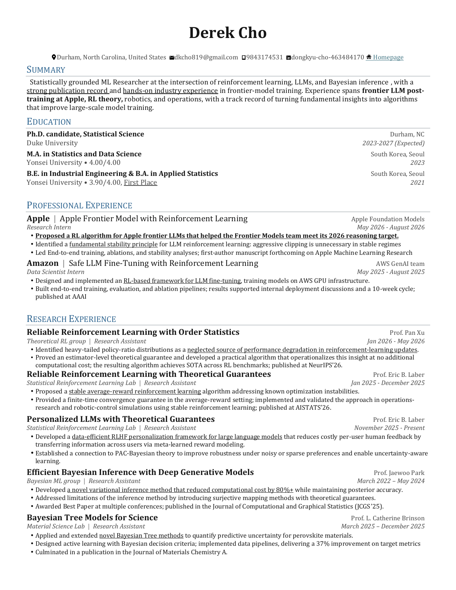
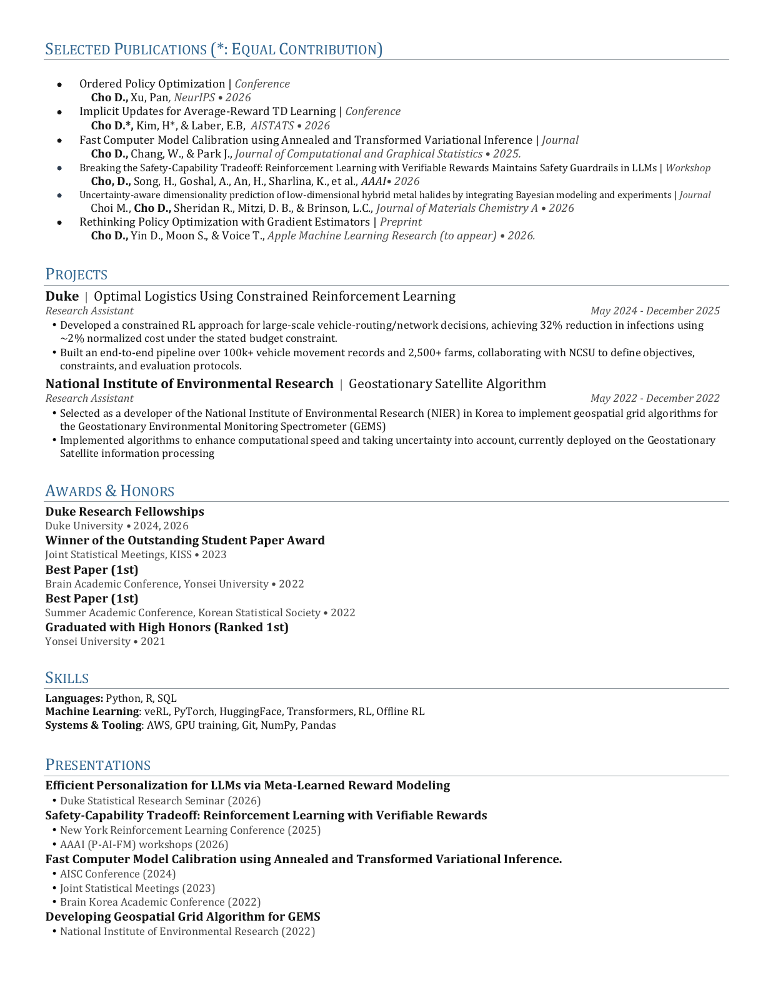

I am a Ph.D. candidate in Statistical Science at Duke University. My research is at the intersection of reinforcement learning, large language models, and Bayesian inference. I aim to build learning systems that are statistically grounded, stable to optimize, and useful in real decision making settings.

Recently, I worked on reinforcement learning for frontier LLMs at Apple Foundation Models and safe LLM fine tuning at AWS GenAI. My academic work spans stable average reward reinforcement learning, robust policy optimization, personalized LLMs, efficient variational inference, and uncertainty aware scientific modeling.

Before Duke, I earned an M.A. in Statistics and Data Science and dual degrees in Industrial Engineering and Applied Statistics from Yonsei University, graduating first in my class. I enjoy working across theory, systems, and applications, including robotics, logistics, materials science, and environmental monitoring.

Please visit **Research & Presentation** and **Projects** to learn more. For my complete CV:

  

    
    
  

