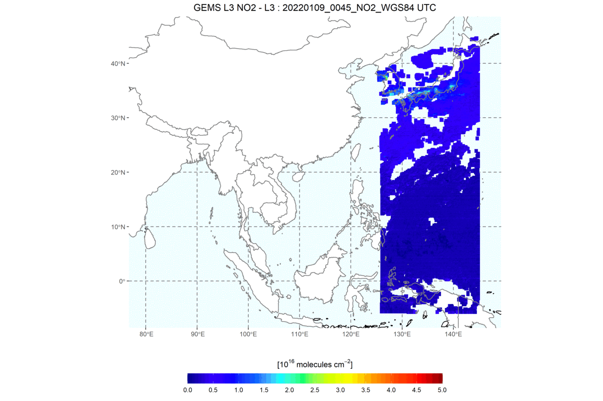

  <section class="research-focus experience-card" aria-labelledby="experience-apple">
    

      
    

    

      <header class="experience-card__header">
      <h2 id="experience-apple">Apple Foundation Models</h2>
      
Research Intern

      
<time datetime="2026-05">May 2026</time> to <time datetime="2026-08">August 2026</time>

      </header>
      
Worked on reinforcement learning for frontier LLMs. I proposed a training algorithm, led end to end training and ablations, and investigated optimization stability in large scale post training.

    

  </section>

  <section class="research-focus experience-card" aria-labelledby="experience-aws">
    

      
    

    

      <header class="experience-card__header">
      <h2 id="experience-aws">AWS GenAI</h2>
      
Data Scientist Intern

      
<time datetime="2025-05">May 2025</time> to <time datetime="2025-08">August 2025</time>

      </header>
      
Designed and implemented a reinforcement learning framework for safe LLM fine tuning on AWS GPU infrastructure. I built training, evaluation, and ablation pipelines; the resulting work was published at AAAI.

    

  </section>

  <section class="research-focus experience-card" aria-labelledby="experience-nier">
    

      
    

    

      <header class="experience-card__header">
      <h2 id="experience-nier">National Institute of Environmental Research</h2>
      
Research Assistant

      
<time datetime="2022-05">May 2022</time> to <time datetime="2022-12">December 2022</time>

      </header>
      
Developed geospatial grid algorithms for the Geostationary Environmental Monitoring Spectrometer (GEMS). The work improved computational efficiency while incorporating uncertainty into the processing pipeline.

    

  </section>

